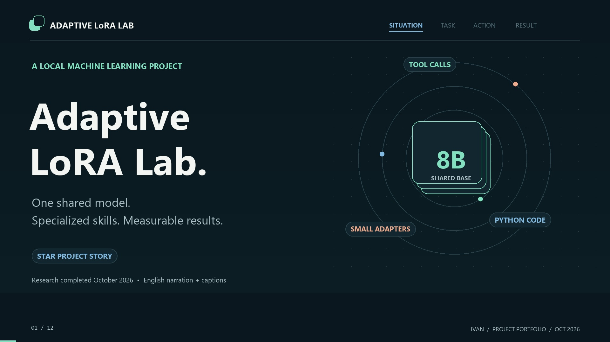
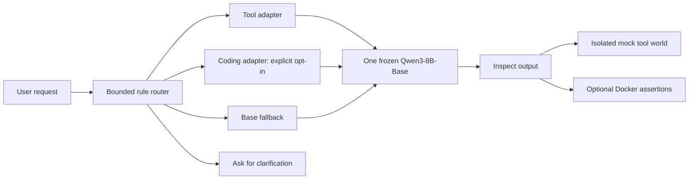

# Adaptive LoRA Lab

**Small specialists. One shared base model. Results you can inspect.**

[](https://github.com/Ivan53040/Adaptive-LoRA-Lab/actions/workflows/ci.yml)
[](LICENSE)

A completed local research project exploring whether task-specific LoRA adapters
can improve tool use and Python code generation on a frozen **Qwen3-8B-Base**.
The work connects data preparation, 4-bit QLoRA training, controlled experiments,
independent evaluation and a bilingual demo with shared-base adapter switching.

**Status:** planned research and local demo completed in October 2026.
This repository includes source code, selected evidence and a portable report
viewer. Training data, model weights and large checkpoint archives stay local.

[繁體中文](docs/README.zh-TW.md) · [Architecture](docs/architecture.md) ·
[Reproduction guide](docs/reproducing.md) · [Evidence index](reports/README.md)

## Watch the project story

[](media/adaptive-lora-lab-star-en-male.mp4)

**[Watch / download the 3:28 film](https://github.com/Ivan53040/Adaptive-LoRA-Lab/raw/refs/heads/main/media/adaptive-lora-lab-star-en-male.mp4)**
— English male AI narration, English captions and original light instrumental music.
The film follows Situation → Task → Action → Result.
[Subtitles](media/adaptive-lora-lab-en.srt) · [Transcript](media/narration-en.txt) · [Credits](media/README.md)

## The question

Can small, interchangeable adapters produce measurable specialist gains over one
shared pretrained model, while keeping routing and verification transparent?

The starting checkpoint is a **Base model**, rather than an instruction-tuned
assistant. Tool training teaches the output protocol as well as tool selection
and arguments. That distinction matters when interpreting the baseline.

## Results

| Experiment | Observed result | Evidence and scope |
| --- | --- | --- |
| Tool specialist, selected 3k/r8 | **893/961 exact calls — 92.92%** | [Official tool test](reports/tool-test-summary.json); 100% valid format and mock execution, with 68 exact-match differences |
| Expanded Coding on known HumanEval164 | **111/164 — 67.68%**, versus Base **98/164 — 59.76%** | [Final report](reports/final-summary.md); net +13 passes, descriptive comparison on a known benchmark |
| Expanded Coding across three training seeds | **53.62% mean pass@1**; 53.12–54.19% observed range | [Seed replication](reports/final-summary.md); the same 465 eligible MBPP tasks across seeds |
| Router integration | **27/27 route contracts**; auto **22/24** vs always-Base **14/24** | [Authored pilot](reports/router-integration.md); both totals include five clarification cases |

The first Coding pilot passed **97/164**, slightly below Base. That negative result
remains visible. Expanded Coding remains an explicit experimental choice;
benchmark results did not automatically change the runtime's Base fallback policy.

## Project story: STAR

**Situation.** Fluent text alone does not guarantee valid tool calls or working
code. The project needed useful specialization within a local GPU workflow.

**Task.** Build small Tool and Coding adapters around one frozen model, compare
them fairly, preserve held-out data and expose the evidence in a usable demo.

**Action.**

1. Normalize schemas and prompts; freeze training, validation and test splits.
2. Train QLoRA adapters and retain configurations, checkpoints and raw predictions.
3. Diagnose an early failure: low teacher-forced loss but malformed generated
   calls. Repair completion-through-EOS supervision and joint transformer/output-head
   adapter training, preserving the failed experiment.
4. Compare ranks, tool training-set sizes and Coding attachment sites. Select on
   validation and repeat training seeds to inspect variation.
5. Integrate manual adapter switching and a bounded rule-based router on one
   shared Base, with isolated mock tools and optional Docker assertions.
6. Independently replay saved Coding programs and rescore Tool predictions;
   document the full 14-stage process in English and Traditional Chinese.

**Result.** A completed local research and demo system with measured task gains,
preserved negative results, traceable experiment artifacts and explicit limits.

## Try the reports in one command

Requires **Python 3.11 or newer**. No packages, model downloads, GPU or Docker
are needed for the public report viewer.

```bash
git clone https://github.com/Ivan53040/Adaptive-LoRA-Lab.git
cd Adaptive-LoRA-Lab
python tools/serve_reports.py
```

Open **[localhost:18765/#pipeline](http://127.0.0.1:18765/#pipeline)**.
Use `python tools/serve_reports.py --port 18766` if the port is occupied.

- Browse the completed 14-stage pipeline and saved benchmark tables.
- Inspect all 68 Tool exact-match differences and the original 164-case Coding review.
- Switch between English and Traditional Chinese.
- Try real CPU route previews, clarification and experimental Coding opt-in.
- Watch the project film.

This entry point serves saved results. It cannot generate model responses or
execute programs. The original model-backed demo is retained for local research;
see the [reproduction guide](docs/reproducing.md).

## How the system fits together



The research pipeline is separate from inference: frozen data → training →
generated validation → selection → benchmark → independent replay → reports.
[Architecture and contracts](docs/architecture.md) describe both paths.

## Repository layout

```text
Adaptive-LoRA-Lab/
├── docs/                     # Architecture, reproduction and historical research log
├── media/                    # Male-narrated film, cover, captions and transcript
├── reports/                  # Curated evidence, provenance hashes and demo snapshot
├── tools/                    # Portable viewer, export and publication checks
├── configs/                  # Frozen model, training and tool-schema configurations
├── training/                 # Tool/Coding trainers and protocol repair
├── experiments/              # Resumable studies and Windows launchers
├── evaluation/               # Scoring, replay, audits and original test suites
├── coding/                   # Coding data preparation and Docker execution
├── runtime/                  # Shared-base generation, mock tools and routing
├── demo/                     # Preserved bilingual UI and original local servers
├── data/evaluation/          # Authored router integration cases
└── .github/workflows/        # Lightweight CPU verification
```

`models/`, `data/raw/`, `data/processed/`, `outputs/`, caches and virtual environments
are ignored. Research source paths are preserved because completed protocols
record their byte-level fingerprints. Public exports do not replace the local archive.

## Verify the public bundle

```bash
python tools/verify_public.py
python -m pip install -r requirements-dev.txt
python -m unittest discover -s evaluation -p test_scoring.py
python -m unittest discover -s evaluation -p test_mock_tools.py
python -m unittest discover -s evaluation -p test_checkpoint.py
```

The first command verifies published hashes, frozen source/config fingerprints,
reported counts, route previews and the report-only HTTP boundary. CI runs these
checks on a clean checkout. Full training, generation and saved-program replay
need the larger environment described in [Reproducing the work](docs/reproducing.md).

## What the evidence does and does not show

- Mock success measures **executability**, not whether arguments match intent.
- HumanEval is a known benchmark here. The expanded comparison is descriptive,
  and was not used for test-driven model selection.
- MBPP results use a **465-task eligible subset**. Three seeds share those tasks;
  their observed range is not a confidence interval.
- Tool rank replication uses 100 validation cases across three seeds. Its r8 lead
  does not establish universal rank superiority.
- Tool data-size runs fix epochs, not compute. Coding expansion changes both data
  quantity and source composition; it is not a pure data-size ablation.
- Synthetic reference correctness and semantic/pretraining decontamination are
  not certified. The router pilot is finite integration coverage, not broad intent accuracy.
- This is a local experiment and portfolio demo, not a production deployment or
  a general claim of model superiority.

## License and acknowledgements

Original project code is released under the **[MIT License](LICENSE)**.
Third-party models and dataset-derived material retain their own licenses;
see **[Third-party notices](THIRD_PARTY_NOTICES.md)**.

Built with PyTorch, Hugging Face Transformers / PEFT / TRL / Datasets,
bitsandbytes, JSON Schema, Docker and HTML/CSS/JavaScript.
Research sources include [Qwen3-8B-Base](https://huggingface.co/Qwen/Qwen3-8B-Base),
[Google Mobile Actions](https://huggingface.co/datasets/google/mobile-actions),
[MBPP](https://huggingface.co/datasets/google-research-datasets/mbpp),
[HumanEval](https://github.com/openai/human-eval) and
[Magicoder OSS Instruct](https://huggingface.co/datasets/ise-uiuc/Magicoder-OSS-Instruct-75K).
