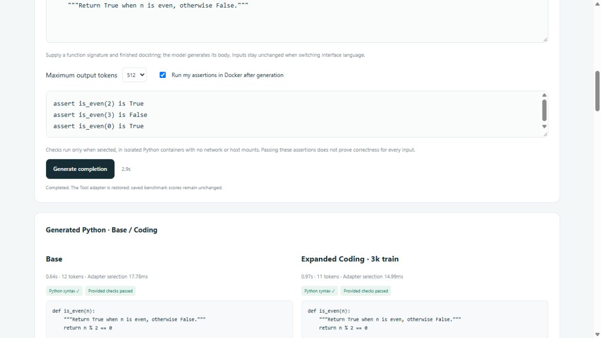
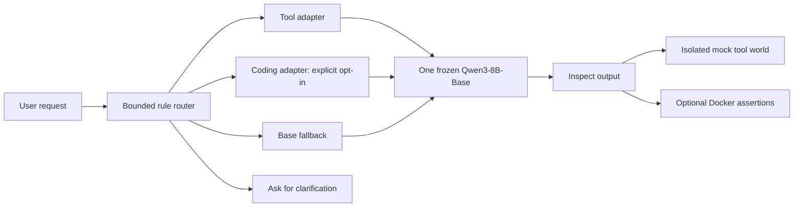

https://github.com/user-attachments/assets/a56c3af9-31eb-4b21-a07d-f3abdbc44f0b

<div align="center">

# Adaptive LoRA Lab

### Small specialists. One shared base model. Results you can inspect.

Task-specific LoRA adapters for **tool calling** and **Python coding**,
trained on a single laptop GPU around one frozen **Qwen3-8B-Base**.

[](https://github.com/Ivan53040/Adaptive-LoRA-Lab/actions/workflows/ci.yml)
[](LICENSE)


[**🎬 Watch the film**](#-watch-the-3-minute-film) ·
[**⚡ Try it in one command**](#-try-the-reports-in-one-command) ·
[**📊 Results**](#-results-at-a-glance) ·
[繁體中文](docs/README.zh-TW.md) ·
[Architecture](docs/architecture.md) ·
[Evidence index](reports/README.md)

</div>

<br>

<table>
<tr>
<td align="center" width="25%">
<h2>92.92%</h2>
<b>Tool calls exactly right</b><br>
<sub>893 / 961 official test cases</sub>
</td>
<td align="center" width="25%">
<h2>+13</h2>
<b>Extra HumanEval passes</b><br>
<sub>111 vs Base 98 out of 164</sub>
</td>
<td align="center" width="25%">
<h2>53.62%</h2>
<b>Mean coding pass@1</b><br>
<sub>3 training seeds on 465 MBPP tasks</sub>
</td>
<td align="center" width="25%">
<h2>27 / 27</h2>
<b>Router contracts met</b><br>
<sub>auto 22/24 vs always-Base 14/24</sub>
</td>
</tr>
</table>

## 🎬 Watch the 3-minute film

<div align="center">

[](media/adaptive-lora-lab-star-en-male.mp4)

🔊 **English narration** &nbsp;·&nbsp; 💬 **English captions** &nbsp;·&nbsp; 🎵 **Original music** &nbsp;·&nbsp; ⏱️ **3:28** &nbsp;·&nbsp; 🖥️ **1080p**

**[▶ Play the full film with sound](media/adaptive-lora-lab-star-en-male.mp4)** ·
[Download MP4](https://github.com/Ivan53040/Adaptive-LoRA-Lab/raw/refs/heads/main/media/adaptive-lora-lab-star-en-male.mp4) ·
[Subtitles (SRT)](media/adaptive-lora-lab-en.srt) ·
[Transcript](media/narration-en.txt) ·
[Credits](media/README.md)

</div>

> *"Can one language model learn several specialist skills without retraining all of its weights?"*

The film walks through the whole project in the **Situation → Task → Action → Result**
format: why fluent text isn't enough, how the adapters were trained, the failed
experiment that fixed the training protocol, and what the measurements show.
It is narrated in English, with English captions burned into the picture so they
show on every player; a separate [SRT subtitle file](media/adaptive-lora-lab-en.srt)
is included for players that load captions on their own.

## 💡 The question

Can small, interchangeable adapters produce measurable specialist gains over one
shared pretrained model, while keeping routing and verification transparent?

The starting checkpoint is a **Base model**, not an instruction-tuned
assistant. Tool training therefore teaches the output protocol as well as tool
selection and arguments. Keep that in mind when reading the baseline numbers.

## 📊 Results at a glance

| Experiment | Observed result | Evidence and scope |
| --- | --- | --- |
| 🛠️ Tool specialist, selected 3k/r8 | **893/961 exact calls: 92.92%** | [Official tool test](reports/tool-test-summary.json); 100% valid format and mock execution, with 68 exact-match differences |
| 🐍 Expanded Coding on known HumanEval164 | **111/164 (67.68%)** vs Base **98/164 (59.76%)** | [Final report](reports/final-summary.md); net +13 passes, descriptive comparison on a known benchmark |
| 🔁 Expanded Coding across three training seeds | **53.62% mean pass@1**; observed range 53.12–54.19% | [Seed replication](reports/final-summary.md); the same 465 eligible MBPP tasks across seeds |
| 🧭 Router integration | **27/27 route contracts**; auto **22/24** vs always-Base **14/24** | [Authored pilot](reports/router-integration.md); both totals include five clarification cases |

> [!NOTE]
> **Negative results stay visible.** The first Coding pilot passed **97/164**,
> slightly below Base. Expanded Coding remains an explicit opt-in: benchmark
> results did not automatically change the runtime's Base fallback policy.

<div align="center">

<br><sub>The local demo: manual adapter switching and routing on one shared Qwen3-8B-Base.</sub>
</div>

## 🧪 How it was built

| | |
| --- | --- |
| **Situation** | Fluent text doesn't guarantee valid tool calls or working code. The project needed useful specialization within a local GPU workflow. |
| **Task** | Build small Tool and Coding adapters around one frozen model, compare them fairly, keep held-out data untouched and expose the evidence in a usable demo. |
| **Result** | A completed local research and demo system with measured task gains, preserved negative results, traceable experiment artifacts and explicit limits. |

**Action, step by step:**

1. **Prepare.** Normalize schemas and prompts; freeze training, validation and test splits.
2. **Train.** Train QLoRA adapters, keeping configurations, checkpoints and raw predictions.
3. **Debug.** Diagnose an early failure where teacher-forced loss was low but
   generated calls were malformed. Fix it with completion-through-EOS supervision
   and joint transformer/output-head adapter training, and keep the failed experiment.
4. **Compare.** Sweep ranks, tool training-set sizes and Coding attachment sites.
   Select on validation and repeat training seeds to inspect variation.
5. **Integrate.** Add manual adapter switching and a bounded rule-based router on
   one shared Base, with isolated mock tools and optional Docker assertions.
6. **Verify.** Independently replay saved Coding programs and rescore Tool
   predictions; document the full 14-stage process in English and Traditional Chinese.

## ⚡ Try the reports in one command

Requires **Python 3.11 or newer**. The public report viewer needs no packages,
model downloads, GPU or Docker.

```bash
git clone https://github.com/Ivan53040/Adaptive-LoRA-Lab.git
cd Adaptive-LoRA-Lab
python tools/serve_reports.py
```

Then open **[localhost:18765/#pipeline](http://127.0.0.1:18765/#pipeline)**.
If the port is taken, run `python tools/serve_reports.py --port 18766`.

What you can do there:

- 🗺️ Browse the completed 14-stage pipeline and saved benchmark tables.
- 🔍 Inspect all 68 Tool exact-match differences and the original 164-case Coding review.
- 🌐 Switch between English and Traditional Chinese.
- 🧭 Try real CPU route previews, clarification and experimental Coding opt-in.
- 🎬 Watch the project film.

This entry point serves saved results. It cannot generate model responses or
execute programs. The original model-backed demo is kept for local research;
see the [reproduction guide](docs/reproducing.md).

## 🧩 How the system fits together



The research pipeline is separate from inference: frozen data → training →
generated validation → selection → benchmark → independent replay → reports.
[Architecture and contracts](docs/architecture.md) describes both paths.

## 📁 Repository layout

```text
Adaptive-LoRA-Lab/
├── docs/                     # Architecture, reproduction and historical research log
├── media/                    # Male-narrated film, preview, cover, captions and transcript
├── reports/                  # Curated evidence, provenance hashes and demo snapshot
├── tools/                    # Portable viewer, export and publication checks
├── configs/                  # Frozen model, training and tool-schema configurations
├── training/                 # Tool/Coding trainers and protocol repair
├── experiments/              # Resumable studies and Windows launchers
├── evaluation/               # Scoring, replay, audits and original test suites
├── coding/                   # Coding data preparation and Docker execution
├── runtime/                  # Shared-base generation, mock tools and routing
├── demo/                     # Preserved bilingual UI and original local servers
├── data/evaluation/          # Authored router integration cases
└── .github/workflows/        # Lightweight CPU verification
```

`models/`, `data/raw/`, `data/processed/`, `outputs/`, caches and virtual environments
are ignored. Research source paths are preserved because completed protocols
record their byte-level fingerprints. Public exports do not replace the local archive.

## ✅ Verify the public bundle

```bash
python tools/verify_public.py
python -m pip install -r requirements-dev.txt
python -m unittest discover -s evaluation -p test_scoring.py
python -m unittest discover -s evaluation -p test_mock_tools.py
python -m unittest discover -s evaluation -p test_checkpoint.py
```

The first command verifies published hashes, frozen source/config fingerprints,
reported counts, route previews and the report-only HTTP boundary. CI runs these
checks on a clean checkout. Full training, generation and saved-program replay
need the larger environment described in [Reproducing the work](docs/reproducing.md).

## ⚖️ What the evidence does and does not show

<details>
<summary><b>Read the limits before quoting the numbers</b></summary>

<br>

- Mock success measures **executability**, not whether arguments match intent.
- HumanEval is a known benchmark here. The expanded comparison is descriptive,
  and was not used for test-driven model selection.
- MBPP results use a **465-task eligible subset**. Three seeds share those tasks;
  their observed range is not a confidence interval.
- Tool rank replication uses 100 validation cases across three seeds. Its r8 lead
  does not establish universal rank superiority.
- Tool data-size runs fix epochs, not compute. Coding expansion changes both data
  quantity and source composition; it is not a pure data-size ablation.
- Synthetic reference correctness and semantic/pretraining decontamination are
  not certified. The router pilot is finite integration coverage, not broad intent accuracy.
- This is a local experiment and portfolio demo, not a production deployment or
  a general claim of model superiority.

</details>

## 📜 License and acknowledgements

Original project code is released under the **[MIT License](LICENSE)**.
Third-party models and dataset-derived material keep their own licenses;
see **[Third-party notices](THIRD_PARTY_NOTICES.md)**.

Built with PyTorch, Hugging Face Transformers / PEFT / TRL / Datasets,
bitsandbytes, JSON Schema, Docker and HTML/CSS/JavaScript.
Research sources include [Qwen3-8B-Base](https://huggingface.co/Qwen/Qwen3-8B-Base),
[Google Mobile Actions](https://huggingface.co/datasets/google/mobile-actions),
[MBPP](https://huggingface.co/datasets/google-research-datasets/mbpp),
[HumanEval](https://github.com/openai/human-eval) and
[Magicoder OSS Instruct](https://huggingface.co/datasets/ise-uiuc/Magicoder-OSS-Instruct-75K).
