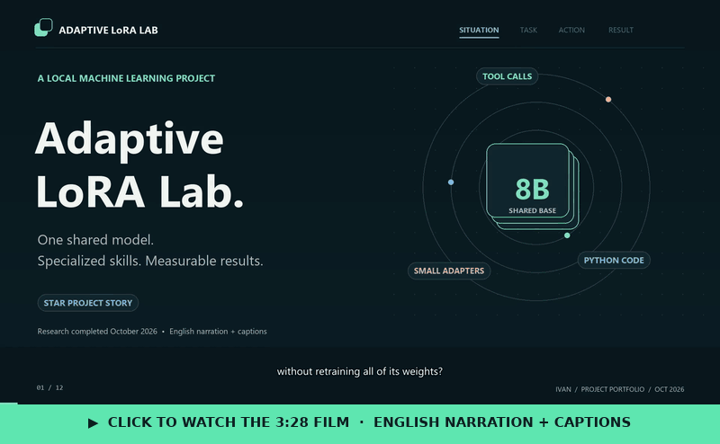

# Project film

[Watch / download](adaptive-lora-lab-star-en-male.mp4) ·
[Subtitles](adaptive-lora-lab-en.srt) · [Narration](narration-en.txt)

- 3 minutes28 seconds;1920×1080 at30fps; H.264 and stereo AAC.
- STAR narrative covering the problem, goal, workflow and measured results.
- English male AI narration generated locally with Kokoro `am_michael`; not a
  clone of the project author's voice.
- English captions embedded in the film, with an editable SRT alongside it.
- Original84BPM instrumental: soft keys, bass, pads and brushed percussion.
- Original diagrams/charts and a recorded screenshot of the local project UI.
- `film-preview.gif`: a silent 12-frame preview (800 px, about 0.4 MB) built from
  still frames of the film. The repository README embeds a playable copy of the
  film (same picture, audio re-encoded at 96 kbps to fit GitHub's 10 MB upload limit).

The roughly11MB film is tracked directly in Git. Production intermediates,
downloaded models and dependencies remain in ignored `outputs/portfolio-video/`.

Kokoro model: [Apache2.0](https://huggingface.co/hexgrad/Kokoro-82M).
Kokoro ONNX wrapper: [MIT](https://github.com/thewh1teagle/kokoro-onnx).
No third-party music recording/sample is included. Model binaries and fonts are
not redistributed here.
